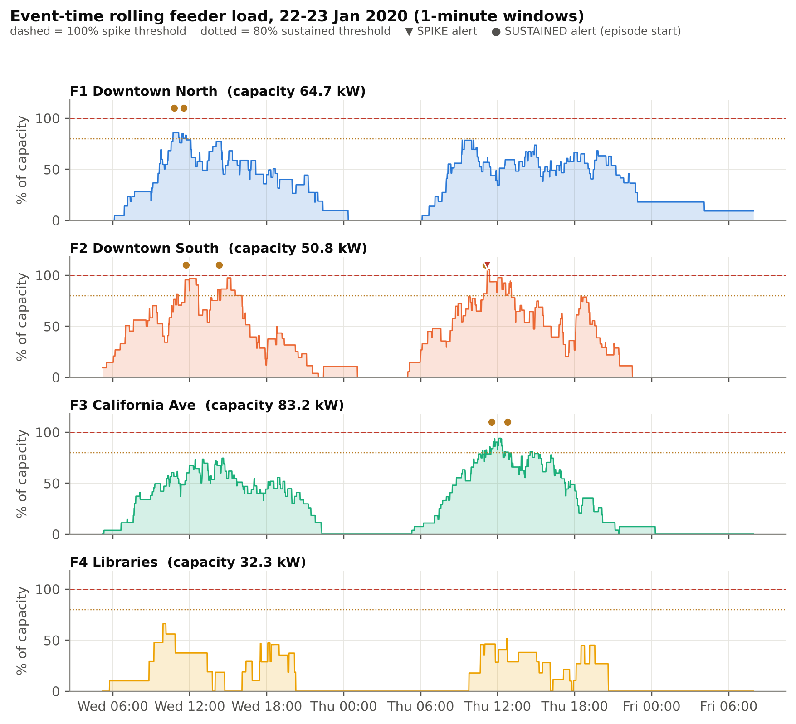
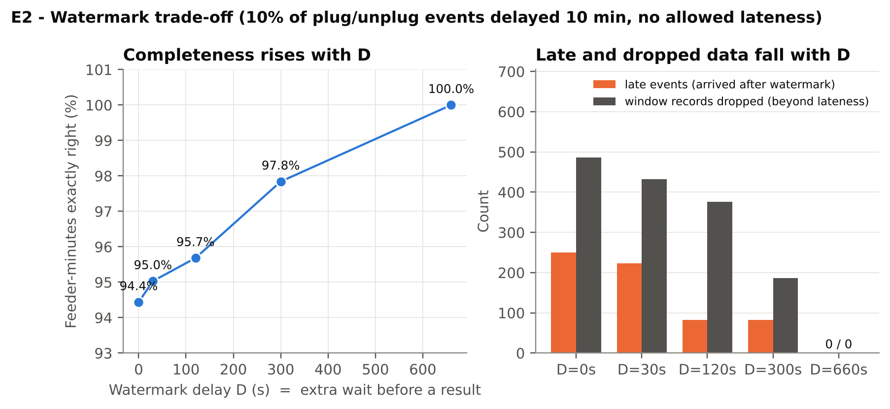
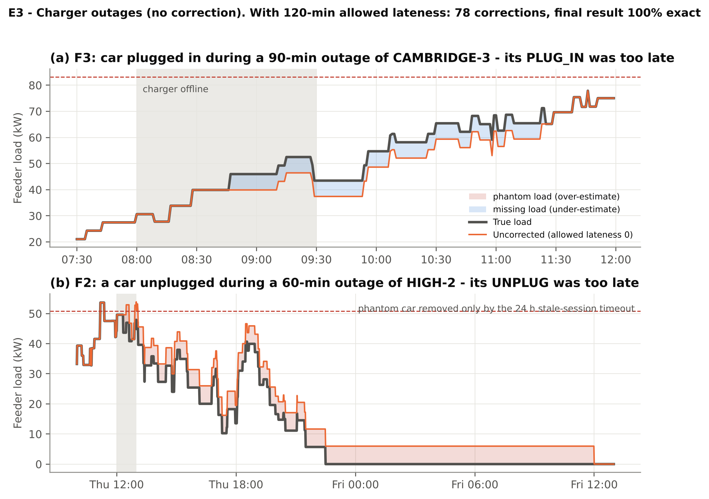
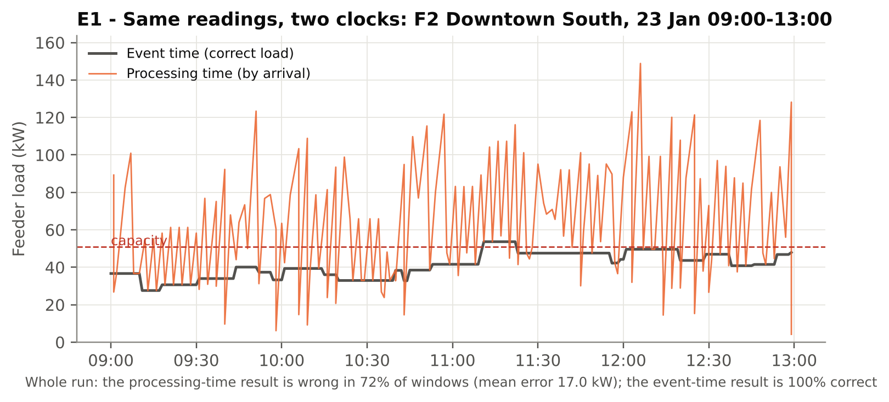
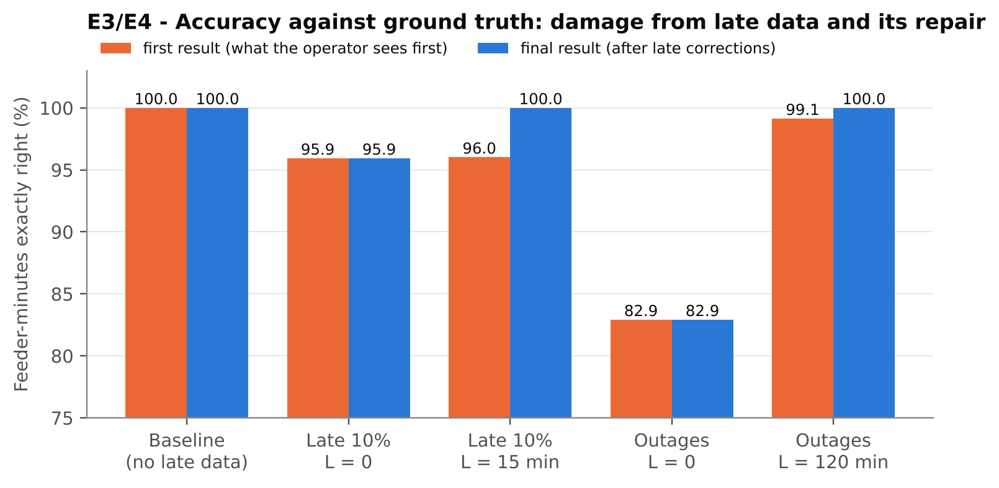
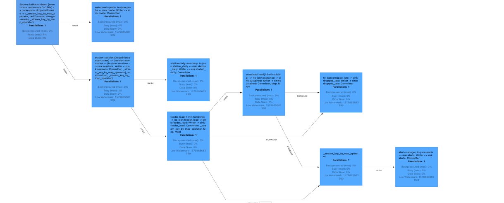
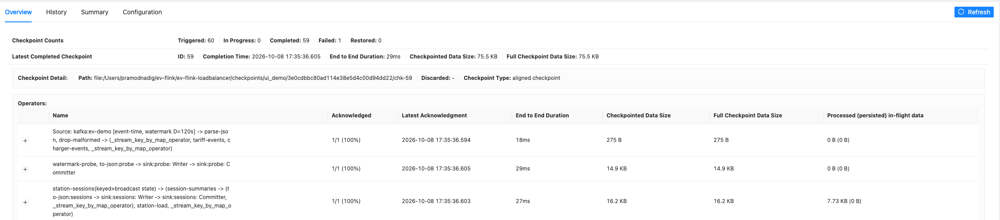
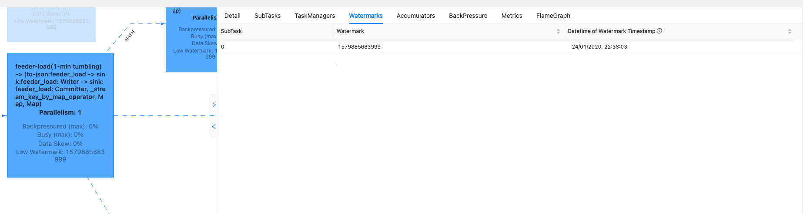
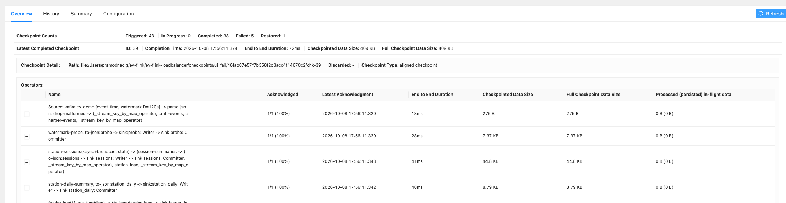

# EV Charging Load Balancer — Apache Flink Streaming Pipeline


-success)

Real-time detection of **local power spikes** and **prolonged high-load periods** on the
electricity feeders that supply public EV chargers — before a feeder becomes overloaded.

Built with **Apache Flink 1.20 (PyFlink)** and **Apache Kafka**, on real charging sessions
from the City of Palo Alto, using event-time processing, watermarks, keyed and broadcast
state, event-time timers, tumbling and sliding windows, allowed lateness with side
outputs, exactly-once checkpointing and custom metrics.

> M.Tech Data Engineering — Module 8, Assignment 15 (Electric-Vehicle Charging Load Balancer)

---

## Results at a glance

All numbers come from controlled, seeded experiments on the two busiest days of the data
(22–23 Jan 2020: 334 sessions, ~46,000 events) and are checked against an offline ground truth.

| Experiment | Finding |
|---|---|
| **E1** event vs processing time | Event-time feeder load is **100 % correct**; the same readings grouped by arrival time are wrong in **72 %** of windows (mean error 17 kW). |
| **E2** watermark sweep (D = 0…660 s) | First-result accuracy **94.4 → 95.0 → 95.7 → 97.8 → 100 %**, late-dropped records **486 → 0**: completeness costs latency. |
| **E3** late plug/unplug (10 %, 10 min late) | Without correction: phantom load (59 min), missing load (284 min) and a false SUSTAINED alert. With 15-min allowed lateness: **346 corrections, final result 100 % exact**; alerts raised on incomplete data were **retracted** (1 SPIKE, 2 SUSTAINED) and **4 overloads detected late**. |
| **E3** charger outages (60/90 min) | Lost UNPLUG → **1,411 minutes of phantom load** until the stale-session timeout; lost PLUG_IN → 158 minutes missing. 120-min allowed lateness repairs everything (100 %). |
| **E5** failure + recovery | Injected crash half-way → automatic restart from checkpoint → outputs **identical** to a crash-free run (exactly-once; no lost sessions, no duplicate alerts). |
| **E6** throughput | Single slot sustains **~1,100 events/s**; pipeline latency **~350 ms (p50)** while keeping up, **~10 s** under saturation (backpressure). |

Charts: [`results/charts/`](results/charts) · per-run metrics: [`results/metrics/`](results/metrics) · Flink Web UI evidence: [`results/screenshots/`](results/screenshots)

<p align="center">
  <br>
  <em>Event-time rolling load of the four feeders with spike and sustained-load alerts</em>
</p>

<table>
<tr>
<td width="50%"><br><em>E2 – completeness vs watermark delay</em></td>
<td width="50%"><br><em>E3 – charger outages: missing and phantom load</em></td>
</tr>
<tr>
<td><br><em>E1 – the same readings on two clocks</em></td>
<td><br><em>E3/E4 – accuracy before and after late corrections</em></td>
</tr>
</table>

---

## Architecture

```mermaid
flowchart LR
    subgraph Data
      A[Palo Alto sessions CSV<br/>259k sessions 2011-2020] --> B[prepare_sessions.py<br/>clean · UTC event time · feeders]
      B --> C[event_generator.py<br/>PLUG_IN · POWER · UNPLUG · TARIFF<br/>jitter · out-of-order · late · outages]
    end
    C --> D[kafka_producer.py<br/>paced replay, record timestamp = event time]
    D --> K[(Kafka topic<br/>ev-&lt;stream&gt;)]
    subgraph Flink["Flink job (PyFlink 1.20)"]
      K --> S[KafkaSource<br/>timestamps + watermarks D]
      S --> P[parse / validate]
      P --> Q[WatermarkProbe<br/>late events per feeder-hour]
      P -->|TARIFF| T[broadcast state]
      P -->|charger events<br/>keyBy station| ST[StationSessions<br/>keyed state: active sessions<br/>per-minute event-time timers]
      T --> ST
      ST -->|station load deltas<br/>keyBy feeder| W1[1-min tumbling window<br/>allowed lateness L]
      W1 --> W2[15-min sliding window]
      W1 --> AL[AlertManager]
      W2 --> AL
      W1 -.->|too late| LO[side output: dropped_late]
      ST -->|session summaries<br/>keyBy station| DS[1-day window<br/>station summary]
    end
    AL --> O[(results/outputs<br/>exactly-once FileSink)]
    W1 --> O
    DS --> O
    Q --> O
    O --> E[evaluate_run.py<br/>ground truth · accuracy · latency]
    E --> G[make_charts.py]
```



**Key design decisions**

| Decision | Why |
|---|---|
| **Event time** for all business logic | Feeder load is a physical quantity at a moment in time; arrival time depends on network delay and replay speed. |
| Timestamps and watermarks **at the Kafka source** | The producer writes `event_time` into the Kafka record timestamp; Flink's Java runtime builds watermarks per partition with no Python in the time path (precise and fast). |
| Sessions kept per **station** in keyed state | "Which cars are connected and what do they draw" is the core context; one state object per station keeps PyFlink state access cheap. |
| Stations report **deltas** per minute from **event-time timers** | A late event can correct an already-published minute: late UNPLUG → negative delta, late PLUG_IN → positive delta. Corrections are emitted from timers set *at the corrected minute* so they carry the right timestamp. |
| Tumbling 1-min windows + **allowed lateness** + **side output** | Corrections within L re-fire the window with the right load; anything later is counted, never silently lost. |
| Sliding 15-min windows for **sustained excursions** | A feeder tolerates a short spike, but a long high load overheats cables and transformers. |
| Alerts per **episode**, with `_LATE` and `_RETRACTED` | Operators get one alert per overload, plus explicit notice when late data reveals or cancels one. |
| Checkpoints + Kafka offsets + transactional FileSink | Exactly-once results across failures (proved in E5). |
| Stale-session TTL (24 h) and correction horizon | Bounds state size; limits the damage of lost events (E3 outages). |

---

## Project structure

```
ev-flink-loadbalancer/
├── env.sh                    # source in every new Terminal (Java 11, Flink, venv, Kafka vars)
├── requirements.txt
├── config/project.json       # ALL settings: window, feeders, capacity, thresholds, tariff, generator, pipeline
├── common/
│   ├── config.py             # config loader
│   └── power_model.py        # the ONE definition of session power (shared by generator + ground truth)
├── scripts/
│   ├── download_data.sh      # fetch the Palo Alto dataset
│   ├── explore_dataset.py    # dataset profile  -> results/logs/dataset_profile.txt
│   ├── prepare_sessions.py   # cleaning rules R0-R8, feeders, capacity calibration
│   ├── setup_kafka.sh        # Kafka storage/service, Flink-Kafka connector, smoke test
│   ├── run_pipeline.sh       # one complete run: topic -> job -> send -> summary
│   └── submit_to_cluster.sh  # run on the standalone cluster (Web UI)
├── generator/
│   ├── event_generator.py    # sessions -> PLUG_IN/POWER/UNPLUG/TARIFF + delays, disorder, outages
│   └── kafka_producer.py     # paced replay into Kafka
├── flink_job/
│   ├── job.py                # the Flink job (dataflow wiring, checkpointing, restart strategy)
│   ├── events.py             # JSON parsing / validation
│   ├── time_semantics.py     # watermark strategy (event time)
│   ├── session_logic.py      # pure-Python session rules (unit-testable)
│   ├── station_sessions.py   # keyed + broadcast state, timers, corrections, cleanup, metrics
│   ├── feeder_load.py        # 1-min tumbling and 15-min sliding window functions
│   ├── alerts.py             # alert episodes, late detections, retractions
│   ├── summaries.py          # daily station summaries, processing-time branch
│   ├── stream_probe.py       # watermark / lateness diagnostics
│   ├── chaos.py              # controlled failure injection
│   └── sinks.py              # exactly-once JSON-lines FileSink
├── analysis/
│   ├── inspect_run.py        # quick summary of one run
│   ├── evaluate_run.py       # ground truth, accuracy, alert precision/recall, latency
│   ├── compare_runs.py       # are two runs identical? (recovery proof)
│   └── make_charts.py        # all report figures
├── experiments/run_experiments.sh   # E1-E6
├── data/{raw,processed,stream}/     # dataset, cleaned sessions, generated streams (not committed)
└── results/{outputs,metrics,logs,charts,screenshots}/
```

---

## Setup (macOS, Apple Silicon)

Expected layout:

```
~/ev-flink/
├── flink-1.20.5/              # Flink binary
├── lib/                       # Flink-Kafka connector jar (created by setup_kafka.sh)
├── .venv/                     # Python 3.11 virtual environment
└── ev-flink-loadbalancer/     # this project
```

**1. Tools** (Homebrew from https://brew.sh):

```bash
brew install openjdk@11 python@3.11 kafka
```

Java 11 is used only for Flink (Flink 1.20 does not support Java 23); Kafka uses Homebrew's own Java.

**2. Flink 1.20.5:**

```bash
mkdir -p ~/ev-flink && cd ~/ev-flink
curl -L -o flink.tgz https://dlcdn.apache.org/flink/flink-1.20.5/flink-1.20.5-bin-scala_2.12.tgz
tar -xzf flink.tgz
```

**3. Python environment + PyFlink.** `apache-beam` (a PyFlink dependency) has no Apple Silicon
package for the versions PyFlink 1.20 needs, so it is built locally with older build tools:

```bash
python3.11 -m venv ~/ev-flink/.venv && source ~/ev-flink/.venv/bin/activate
pip install --upgrade pip
pip install "setuptools<70" wheel "numpy<1.25"
pip install --no-build-isolation -r ~/ev-flink/ev-flink-loadbalancer/requirements.txt
pip install "setuptools<81"
```

**4. Every new Terminal:**

```bash
source ~/ev-flink/ev-flink-loadbalancer/env.sh
```

It prints a health check (Java, Python, Flink, cluster, Kafka, connector).

**5. Kafka (once):**

```bash
cd ~/ev-flink/ev-flink-loadbalancer && bash scripts/setup_kafka.sh
```

**6. Data (once):**

```bash
bash scripts/download_data.sh
python scripts/explore_dataset.py
python scripts/prepare_sessions.py
```

---

## Running

**One complete run** (local embedded Flink cluster):

```bash
python generator/event_generator.py --name demo --start-local "2020-01-22 00:00" --days 2 \
       --late-fraction 0.10 --clean
bash scripts/run_pipeline.sh demo demo            # topic -> job -> send (900x) -> summary
python analysis/evaluate_run.py demo              # compare with ground truth
```

**Useful job options** (`python flink_job/job.py --help`):

| Option | Meaning | Default |
|---|---|---|
| `--watermark-s` | bounded out-of-orderness D | 120 |
| `--allowed-lateness-min` | window allowed lateness L | 15 |
| `--horizon-min` | how long late events may still correct results | 30 |
| `--idleness-s` | mark idle sources (0 = off) | 0 |
| `--checkpoint-s` | checkpoint interval | 10 |
| `--state-backend` | `hashmap` or `rocksdb` | hashmap |
| `--fail-after N` | inject one failure after N events | off |
| `--proc-time-branch` | also compute processing-time load (E1) | off |
| `--timestamps payload` | fallback: read event time from JSON instead of Kafka timestamp | source |

**Generator options** (`python generator/event_generator.py --help`): `--late-fraction`,
`--late-delay-min`, `--late-types`, `--ooo-fraction`, `--ooo-max-delay-s`, `--jitter-max-s`,
`--outage STATION "YYYY-MM-DD HH:MM" MINUTES`, `--start-local`, `--days`, `--seed`.

**All experiments** (~70 min, unattended):

```bash
bash experiments/run_experiments.sh all
python analysis/make_charts.py
```

**On the standalone cluster with the Web UI** (http://localhost:8081):

```bash
start-cluster.sh
python generator/kafka_producer.py --name demo --create-topic
bash scripts/submit_to_cluster.sh --stream demo --run ui_demo --unbounded
python generator/kafka_producer.py --name demo --send --speedup 300
```

Custom metrics appear under the operator `station-sessions` and `alert-manager` with the
prefix `ev.`: `events_in`, `late_events`, `events_beyond_horizon`, `sessions_opened`,
`sessions_closed`, `sessions_stale`, `active_sessions`, `load_corrections`,
`alerts_raised`, `alerts_retracted`, `alerts_late_detected`.

---

## Outputs

Each run writes JSON-lines files to `results/outputs/<run>/<sink>/`:

| Sink | One row per | Key fields |
|---|---|---|
| `feeder_load` | feeder-minute window firing | `load_kw`, `pct`, `firing`, `revision` |
| `sustained` | 15-min sliding window firing | `avg_kw`, `pct`, `minutes_over_capacity` |
| `alerts` | alert | `alert_type` (SPIKE, SUSTAINED, `_LATE`, `_RETRACTED`), `event_time`, `pct` |
| `sessions` | finished charging session | energy (measured / reported / by tariff period), `cost_usd`, `status`, late flags |
| `station_daily` | station and local day | sessions, energy, cost, average duration |
| `dropped_late` | record too late for a window | `dropped_by` |
| `probe` | feeder and hour | events, late events, max lateness, corrections |
| `proc_time_load` | processing-time window (E1 only) | `load_kw` by arrival time |

---

## Flink Web UI

| Job graph | Checkpoints |
|---|---|
|  |  |
| **Event-time watermark** (shows 2020 event time, not wall time) | **Recovery after a TaskManager was killed** (`Restored: 1`) |
|  |  |

---

## Dataset and assumptions

* **Data:** City of Palo Alto, *Electric Vehicle Charging Station Usage (July 2011 – Dec 2020)*,
  ChargePoint sessions, Open Data Commons PDDL.
  https://data.paloalto.gov/datasets/194693/electric-vehicle-charging-station-usage-july-2011-dec-2020/
* **Cleaning:** 259,415 raw sessions → 257,195 clean (99.1 %) with counted rules R0–R8.
* **Replay window:** 13–26 Jan 2020 (the busiest pre-COVID weeks); experiments use 22–23 Jan.
* **Assumptions** (no public data exists for these):
  * stations are grouped into 4 feeders by area;
  * feeder EV capacity = charging ports × 6.6 kW × diversity factor 0.7, calibrated so
    overloads are rare but present;
  * power is constant during the recorded charging time (energy ÷ charging time) and is
    reported every 60 s;
  * an illustrative time-of-use tariff (0.20 / 0.28 / 0.42 USD per kWh);
  * network effects (jitter, out-of-order, late events, outages) are injected with a fixed seed.

---

## Troubleshooting

| Symptom | Fix |
|---|---|
| `zsh: command not found: brew` after installing | `echo 'eval "$(/opt/homebrew/bin/brew shellenv)"' >> ~/.zprofile` and open a new Terminal |
| `Failed to build 'apache-beam'` / `No module named 'pkg_resources'` | use the 3-step install in Setup step 3 |
| Flink errors mentioning Java 17+/23 | `source env.sh` (sets `JAVA_HOME` to Java 11) |
| `start-cluster.sh` says "already running" | `stop-cluster.sh` twice, check `jps`, start once |
| `Kafka connector jar not found` | `bash scripts/setup_kafka.sh` and `source env.sh` |
| Kafka not running | `brew services restart kafka`; log: `$(brew --prefix)/var/log/kafka/` |
| Job seems slow / stuck after sending | normal for a few seconds; check `results/logs/<run>.job.log`; lower `--speedup` if latency grows |
| Error that the record timestamp is missing | add `--timestamps payload` to the job arguments |

---

## References

* Apache Flink 1.20 documentation: Timely Stream Processing; Generating Watermarks; Working with State; Broadcast State; Windows (allowed lateness, side outputs); Checkpointing; Metrics; Kafka connector.
* Begoli, E. et al. (2021). Watermarks in Stream Processing Systems: Semantics and Comparative Analysis of Apache Flink and Google Cloud Dataflow. *PVLDB* 14(12), 3135–3147.
* Fragkoulis, M., Carbone, P., Kalavri, V., Katsifodimos, A. (2024). A Survey on the Evolution of Stream Processing Systems. *The VLDB Journal* 33(2), 507–541.
* Mei, Y. et al. (2025). Disaggregated State Management in Apache Flink 2.0. *PVLDB* 18(12), 4846–4859.
* Tayri, A., Ma, X. (2025). Grid Impacts of Electric Vehicle Charging: A Review of Challenges and Mitigation Strategies. *Energies* 18(14), 3807.
* Iranpour, M. et al. (2025). An Automated Framework for Assessing Electric Vehicle Charging Impacts on a Campus Distribution Grid. arXiv:2509.16218.

---

## Author

**Pramod R Nadig** — M.Tech Data Engineering

## License

Code: MIT (see [`LICENSE`](LICENSE)). Dataset: City of Palo Alto, Open Data Commons PDDL.
